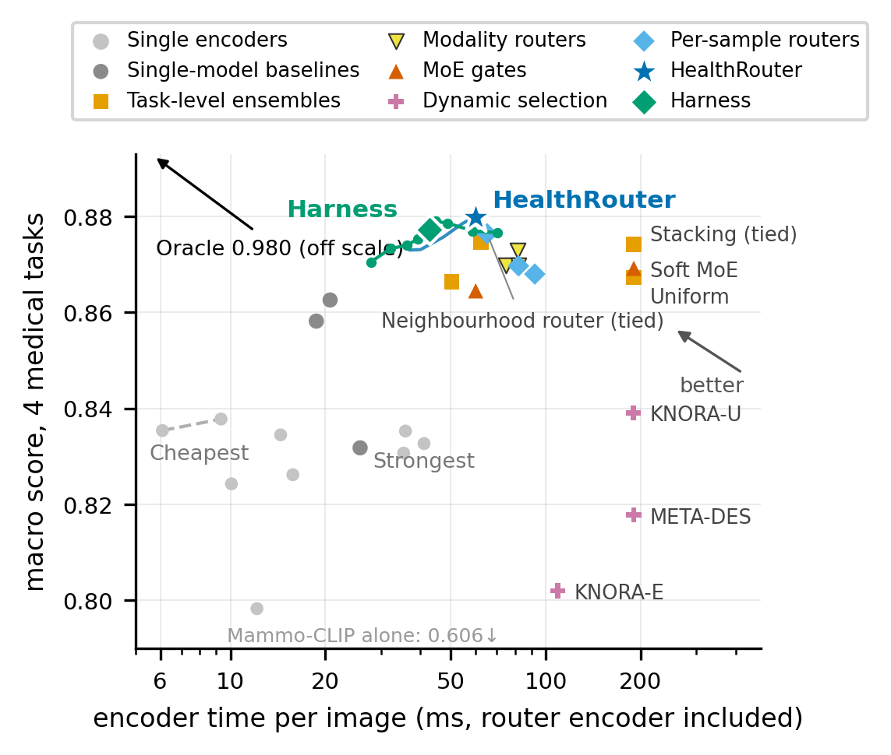

# HealthRouter: Per-Sample Routing to Model Collections

   

HealthRouter decides, for each image, which **collection** of frozen models to run and averages them. It never sees a task or modality label. It scores every small collection by its cross-fitted log-likelihood on the image's nearest training images in a cheap shared embedding. A confidence-gated **harness** calls the chosen models in score order and stops once the fused prediction is confident.

**On one pool of ten frozen encoders and four pooled medical tasks, HealthRouter has the highest macro score of 20 routers and ensembles (0.8798 [0.8687, 0.8907]).** It is significantly better than soft MoE (+0.0106), sparse MoE, KNORA-U (+0.0407), KNORA-E, META-DES, RouterBench/RouteLLM-style routers and modality routers. It is statistically tied with stacking (+0.0056 [-0.0001, 0.0116]) and with a single-model neighbourhood router. The harness beats the uniform ten-model ensemble (+0.0100 [0.0043, 0.016]) with 1.813 calls per image instead of 10.

This research artifact is not a medical device. It evaluates public benchmarks. It does not establish prospective clinical performance or regulatory clearance.



## 📰 News

- **2026-11** Method paper: per-sample routing to model collections, the confidence-gated harness, and 18 baselines (single models, stacking, greedy ensemble selection, LogME, modality routers, soft/sparse MoE, KNORA-U/E, META-DES, neighbourhood, predictive and matrix-factorisation routers) under one frozen evaluation plan (`results/router_plan.json`).
- **2026-11** Benchmark version: matched-resolution ten-encoder grid, five-lane executed dispatch on five external cohorts, calibrated abstention. These are kept as the evaluation suite below.
- **2026-08** Earlier protocol (documented in the supplement): four-encoder grid with released preprocessing, two-lane executed dispatch, exact-duplicate audit.

## What is released

- `healthrouter/collection/`: the method (`methods.collection_router`, `methods.smart_harness`), every baseline (`methods.py`), candidate cross-fitting (`candidates.py`), metrics and the paired bootstrap (`metrics.py`).
- `scripts/router_*.py`: candidate building, the frozen-plan experiment runner, aggregation, external transfer under shifts, feature extraction, and the paper tables and figures.
- `results/router_plan.json` (frozen plan with logged amendments), `results/router_main.json`, `results/router_main_harness.json` and the other `results/router_*.json` result files.
- The benchmark suite: `matched_grid`, `dispatch`, `abstention`, `openset`, `chest_resolution`, `finetune` and the earlier protocol, with figures regenerated only from committed `results/*.json`.

## Install

```bash
python3 -m venv .venv
source .venv/bin/activate
python -m pip install --upgrade pip
pip install -r requirements.txt
export SSL_CERT_FILE="$(python -m certifi)"
export PYTORCH_ENABLE_MPS_FALLBACK=1
```

For the exact direct-dependency versions used to refresh the committed results, install `requirements-lock.txt` instead. The lock snapshot was tested with Python 3.13.7 on macOS 14.8.9. The looser file is the portable starting point.

## Quickstart

The smoke test is procedural, downloads nothing, and does not claim a scientific result:

```bash
python run_experiment.py --smoke --out /tmp/healthrouter-smoke
```

It exercises deterministic seeding, the metric/bootstrap path, and JSON result writing on ten generated route labels.

## Results

### Router: four pooled medical tasks (`results/router_main.json`)

Test score (AUROC; QWK for fundus), seed-averaged over three split seeds, 95% paired bootstrap CI on the macro score. "Calls" = candidates run per image.

| Method | Chest | Pathology | Fundus | Mammography | Macro [95% CI] | Calls |
|:--|--:|--:|--:|--:|--:|--:|
| **HealthRouter** | **0.9719** | 0.988 | 0.8569 | 0.7026 | **0.8798** [0.8687, 0.8907] | 2.552 |
| **HealthRouter harness** | 0.962 | 0.9862 | 0.8534 | **0.7075** | 0.8773 [0.8657, 0.8888] | 1.813 |
| Neighbourhood router | 0.9643 | 0.9871 | 0.8517 | 0.7026 | 0.8764 [0.8639, 0.8877] | 2.866 |
| Greedy ensemble selection | 0.9685 | **0.9892** | 0.853 | 0.6881 | 0.8747 [0.8627, 0.8863] | 2.828 |
| Stacking | 0.9678 | 0.9888 | 0.8396 | 0.7005 | 0.8742 [0.8625, 0.8854] | 10.0 |
| Soft MoE | 0.9616 | 0.9879 | 0.8478 | 0.6795 | 0.8692 [0.8584, 0.8801] | 10.0 |
| Uniform ensemble | 0.9513 | 0.9775 | 0.8339 | 0.7065 | 0.8673 [0.8545, 0.88] | 10.0 |
| Sparse top-k MoE | 0.9623 | 0.9873 | 0.8388 | 0.6697 | 0.8645 [0.8533, 0.8747] | 2.667 |
| Best single per task | 0.9591 | 0.9872 | 0.8408 | 0.6633 | 0.8626 [0.8514, 0.8736] | 1.0 |
| KNORA-U | 0.9364 | 0.9751 | 0.8345 | 0.6104 | 0.8391 [0.8269, 0.851] | 9.948 |
| META-DES | 0.9079 | 0.9588 | 0.7898 | 0.6147 | 0.8178 [0.805, 0.8304] | 10.0 |

All 18 baselines, per-task intervals and paired differences are in `results/router_main.json`.

### Router: external cohorts under acquisition shift (`results/router_external.json`)

Trained in-source, applied unchanged to Montgomery, Camelyon17-WILDS (OOD hospital), IDRiD and CMMD (2,050 images). Macro score over the four cohorts.

| Method | Clean | Grayscale | Blur | Low-res | JPEG |
|:--|--:|--:|--:|--:|--:|
| HealthRouter | 0.7678 | 0.7243 | 0.691 | 0.6598 | 0.5794 |
| Best single per task | 0.7799 | 0.7748 | 0.7312 | 0.6723 | 0.6328 |
| Uniform ensemble | 0.7575 | 0.6906 | 0.7212 | 0.7084 | 0.6726 |
| Stacking | 0.773 | 0.7527 | 0.707 | 0.6907 | 0.5771 |
| Soft MoE | 0.7477 | 0.6988 | 0.6788 | 0.657 | 0.5306 |

**HealthRouter's in-distribution lead does not transfer.** It stays at or above both MoE gates, but under each shift a task-level ensemble or single model is significantly better. A post-hoc distance fallback (plan amendment 3) helps under low resolution and JPEG but does not close the gap. See `results/router_ood_flag.json` for why: the out-of-scope flag fires on chest and mammography, not on the fundus images where the router fails.

### Router: two non-medical domains (`results/router_general.json`)

EuroSAT (10 classes) and DTD (47 classes) pooled with the four medical tasks, no domain label: HealthRouter has the highest six-task macro score (0.8845 [0.8763, 0.8922]) but is not best on EuroSAT or DTD alone (stacking 0.9658 vs 0.9598 on EuroSAT).

### Router: descriptive analyses of plan amendment 4 (`results/router_descriptive.json`)

Logged in `results/router_plan.json` after all test scoring. They change no configuration and are reported whatever they show.
- **Label-free inference**: the task is voted by HealthRouter's own K neighbours and selects each candidate's head. In distribution 2 of 11,514 image evaluations are voted wrong and the macro score is unchanged (0.8798). With EuroSAT and DTD the DTD vote is 96.4% correct and the six-task score drops to 0.8795. External vote accuracy is 97.2% to 99.9%.
- **Every encoder alone**: four different encoders are best on the four medical tasks.
- **Gain calibration**: on average the realised log-likelihood gain over the task's best single encoder is positive, but the per-image Spearman correlation between estimated and realised gain is about zero (pooled 0.018).
- **Harness difficulty**: images where the harness stops after one model are easier for the best single model on every task.

The rest of this section is the benchmark suite on which the candidate pool is built.


All rows are measured by this release on one laptop. Bracketed intervals are stratified item bootstraps on fixed evaluation items; they do not include retraining or population variability.

### Q1: no frozen encoder serves every modality (matched-resolution grid)

Ten frozen encoders, four modalities, identical square pixels per resolution, tuned linear head, five folds repeated over three seeds (`results/matched_grid.json`, `results/universal_regret.json`).

| Evaluation | Metric | Measured result |
|:--|:--|--:|
| RAD-DINO minus DINOv2-B (same ViT-B/14, same objective), chest, 224 px | AUROC gain | **+0.0499 [+0.0297, +0.0709]** |
| RAD-DINO minus DINOv2-B, chest, 448 px | AUROC gain | **+0.0497 [+0.0307, +0.0694]** |
| Phikon minus DINOv2-B, pathology, 224 px | AUROC gain | **+0.0409 [+0.0333, +0.0489]** |
| Phikon-v2 minus DINOv2-L (same ViT-L, same objective), pathology, 224 px | AUROC gain | **+0.0270 [+0.0203, +0.0339]** |
| RETFound minus DINOv2-L, fundus, 224 px | QWK gain | +0.0078 [−0.0248, +0.0410] |
| Mammo-CLIP minus ImageNet ConvNeXt-T, mammography, 224 px | AUROC gain | −0.0020 [−0.0501, +0.0473] |
| RAD-DINO minus DINOv2-B on pathology / fundus, 224 px | AUROC / QWK gain | −0.0317 / −0.0873 |
| Best single encoder for all four modalities (RETFound), 224 px | worst-modality gap to the per-modality best | 0.0471 |

### Q2: executed five-lane dispatch on five external cohorts

2,662 external images (Montgomery, CVC-ClinicDB, Camelyon17-WILDS OOD hospital, IDRiD, CMMD); shifts are applied to the gate input only (`results/dispatch.json`). Retained skill = (lane metric with routing − metric with null outputs) / (metric with reference routing − metric with null outputs), macro-averaged over lanes.

| Gate | Clean: accuracy / retained skill | JPEG q10: accuracy / retained skill | Grayscale: accuracy / retained skill |
|:--|--:|--:|--:|
| Supervised ConvNeXt-T gate | 0.9996 / 0.9996 | 0.8167 / **0.7573** | 0.9639 / 0.9606 |
| Frozen ImageNet probe | 0.9989 / 0.9991 | 0.9455 / 0.9484 | 0.9557 / 0.9406 |
| Probe + grayscale augmentation | 0.9989 / 0.9991 | 0.8651 / 0.7035 | 0.9951 / 0.9954 |
| Zero-shot BiomedCLIP (no routing labels) | 0.9981 / 0.9998 | 0.9974 / **0.9962** | 0.9741 / 0.9955 |

### Q3: calibrated abstention and out-of-scope inputs

Learn-then-Test threshold (alpha = 0.02, delta = 0.05, Bonferroni over 100 thresholds) chosen on a grouped calibration half (1359 items) and scored on the test half (1303 items) (`results/abstention.json`, `results/openset.json`).

| Supervised gate | Threshold | Test coverage | Test misroute rate |
|:--|--:|--:|--:|
| Calibrated clean, deployed clean | 0.00 | 1.0000 | 0.0000 |
| Calibrated clean, deployed JPEG | 0.00 | 1.0000 | **0.1827** |
| Calibrated grayscale, deployed grayscale | 0.98 | 0.6992 | 0.0066 |

Out-of-scope inputs (300 breast-ultrasound, 300 dermoscopy images) are all dispatched at the clean-calibrated threshold; a k-NN feature-distance check rejects 0.5533 of the ultrasound and 0.8600 of the dermoscopy images while keeping 0.9470 of in-scope test items.

### Same-task public context: open models

Ark+ is relevant public context because its authors report Shenzhen TB AUROC. It is not a matched baseline: Shenzhen is one of Ark+'s multi-dataset pretraining tasks, its backbone and resolution differ, and HealthRouter uses paired five-fold out-of-fold logistic probes.

- **HealthRouter RAD-DINO probe (earlier released-preprocessing protocol):** 0.9816 ± 0.0050 Shenzhen TB AUROC on a paired five-fold OOF evaluation of 662 images, with RAD-DINO's released 518 px processor and an untuned head. This is measured here, and ± is fold SD. Under the matched-resolution protocol with a tuned head, RAD-DINO scores 0.9697 at 224 px and 0.9782 at 448 px (`results/matched_grid.json`).
- **Ark+:** 0.9907 ± 0.0006 Shenzhen TB AUROC under the authors' multi-dataset pretraining and evaluation protocol. This is reported context, not a head-to-head result.

The Ark+ value is converted from percent units in [Supplementary Table 4](https://static-content.springer.com/esm/art%3A10.1038%2Fs41586-025-09079-8/MediaObjects/41586_2025_9079_MOESM1_ESM.pdf) of the [primary Nature paper](https://doi.org/10.1038/s41586-025-09079-8). Its value, conversion, source location, URL, and protocol warning are persisted in `results/reported_context.json`. We make no state-of-the-art claim.

### Commercial and closed-system context

Commercial imaging products and closed multimodal services are capability context, not experimental baselines in this repository. A report-generating service, an alert-only clinical device, a classifier, and a pixel-mask segmenter have different outputs, cohorts, operating points, and regulatory evidence. No commercial API or product was run on these fixed test items, so HealthRouter does not claim numerical superiority, feature parity, clinical readiness, or regulatory equivalence. A fair closed-system comparison would require the same inputs, target definition, output metric, and prospective protocol.

## Reproduce

### Reproduce the paper's numbers from the released benchmark files

HealthRouter-Bench (the companion data release in [`dataset/`](dataset/), CC BY-NC 4.0) holds split definitions, cross-fitted encoder predictions, router features and every method's test outputs for the sources whose terms allow it (PatchCamelyon, CBIS-DDSM, EuroSAT, Camelyon17-WILDS, IDRiD, CMMD). No images and no cache are needed:

```bash
pip install -r requirements.txt
export PYTHONPATH=$PWD
python scripts/release_reproduce.py --bench /path/to/HealthRouter-Bench --out reproduce_report.json
# -> "reproduced 499/499 values from the released files"
```

This recomputes the pathology and mammography columns of the main table (all 20 routers and ensembles plus ablations), the EuroSAT column of the six-task table, the single-encoder scores, and the per-cohort external scores under all five conditions. It then compares each value with the aggregate result files. Macro scores need the Shenzhen and APTOS artefacts, which you rebuild from your own downloads with the steps below. `scripts/release_build.py` is the script that produced the benchmark files from the local caches.

### Router experiments

The router reads the cached frozen features of the benchmark suite (`$HEALTHROUTER_CACHE/features/*.npz`, produced by `--method grid_features` below) and never touches pixels again, except for the external and non-medical feature extraction.

```bash
export PYTHONPATH=$PWD
python scripts/router_candidates.py                                   # cross-fitted candidate predictions, 3 split seeds x 5 folds
python scripts/router_text_prompts.py                                 # BiomedCLIP prompts for the zero-shot modality router
python scripts/router_experiment.py --phase dev                       # validation-only development (never scores test)
python scripts/router_experiment.py --phase final --tag main          # HealthRouter, harness, 18 baselines, ablations
python scripts/router_aggregate.py --tag main                         # paired bootstrap -> results/router_main.json
python scripts/router_aggregate.py --tag main --ours healthrouter_harness --out results/router_main_harness.json
python scripts/router_extract.py --what external                      # external cohorts x 5 acquisition conditions
python scripts/router_external.py && python scripts/router_external.py --aggregate
python scripts/router_extract.py --what nonmedical                    # EuroSAT and DTD subsamples
python scripts/router_jepa.py                                         # I-JEPA router-feature ablation
python scripts/router_descriptive.py                                  # amendment 4: label-free inference, encoders alone, gain, difficulty
python scripts/router_schematic.py                                    # method figure (drawing only)
python scripts/router_paper_assets.py path/to/paper                   # tables, figures, derived numbers (calls router_exemplar_assets.py)
```

Every step caches and resumes. On a 16 GB laptop, run one step at a time.

### Benchmark suite

Full runs read datasets and checkpoints in place. Point the environment variable to a directory containing both `data/` and the supplied checkpoint files:

```bash
export HEALTHROUTER_DATA_ROOT="/absolute/path/to/HealthRouter/experiments"

python run_experiment.py --method router       --seed 0 \
  --data-root "$HEALTHROUTER_DATA_ROOT" --out results
python run_experiment.py --method tb_probes    --seed 0 \
  --data-root "$HEALTHROUTER_DATA_ROOT" --out results
python run_experiment.py --method encoder_grid --seed 0 \
  --data-root "$HEALTHROUTER_DATA_ROOT" --out results
python run_experiment.py --method cascade      --seed 0 \
  --data-root "$HEALTHROUTER_DATA_ROOT" --out results
python run_experiment.py --method specialists  --seed 0 \
  --data-root "$HEALTHROUTER_DATA_ROOT" --out results
python run_experiment.py --method aggregate --out results
python scripts/make_figures.py
```

The CVPR 2027 experiments (matched-resolution grid, five-lane dispatch, calibrated abstention, out-of-scope inputs, resolution sweep, fine-tuning check) additionally read five public external cohorts and the out-of-scope samples from `HEALTHROUTER_EXTERNAL_ROOT` and cache derived pixels and features outside the repository in `HEALTHROUTER_CACHE`:

```bash
export HEALTHROUTER_EXTERNAL_ROOT="/absolute/path/to/external_data"   # see Data access
export HEALTHROUTER_CACHE="/absolute/path/to/cache"                    # never commit this

python run_experiment.py --method grid_features    --data-root "$HEALTHROUTER_DATA_ROOT"
python run_experiment.py --method matched_grid     --data-root "$HEALTHROUTER_DATA_ROOT" --out results
python run_experiment.py --method regret           --out results
python run_experiment.py --method chest_resolution --data-root "$HEALTHROUTER_DATA_ROOT" --out results
python run_experiment.py --method dispatch         --data-root "$HEALTHROUTER_DATA_ROOT" --out results
python run_experiment.py --method abstention       --out results
python run_experiment.py --method openset          --data-root "$HEALTHROUTER_DATA_ROOT" --out results
python run_experiment.py --method finetune         --data-root "$HEALTHROUTER_DATA_ROOT" --out results
python scripts/cvpr_figures.py
```

Every step caches its intermediate arrays on disk and resumes after an interruption. The same one-step-at-a-time advice applies.

The whole suite takes 1691.49 s on one Apple M2 Pro laptop (938.39 s of that is the four-encoder grid, 143.85 s the executed dispatch). The probe and grid pin RAD-DINO revision `110cbc18d5133582e320b43d53bf5c44e410c936` and download `facebook/dinov2-base` and `facebook/dinov2-large` from the Hugging Face Hub. `--seed` controls process seeding and router-baseline fitting. The committed bootstrap and router-subset paths use the recorded seed 2026. Supplied neural checkpoints are evaluated frozen, and intervals resample fixed evaluation items rather than repeated training seeds.

To regenerate only the release visuals, no image data or checkpoint is needed:

```bash
python scripts/make_figures.py
```

Expected outputs are `figure_1_teaser`, `pipeline_schematic`, `encoder_attribution`, `routing_dispatch`, `diagnostic_scorecard`, and `chest_folds`, each as PDF and 300-dpi PNG, plus `figures/figures.json` with draft captions and takeaways.

## Data access

Raw medical images and third-party checkpoints are deliberately excluded. The full runner expects this layout beneath `$HEALTHROUTER_DATA_ROOT`:

```text
data/
  ChinaSet_AllFiles/CXR_png/             Shenzhen TB
  MontgomerySet/CXR_png/                 external TB test
  Kvasir-SEG/ and kvasir_yolo/           polyp train/validation data
  cvc_clinicdb/*/{images,masks}/         external polyp test
  aptos_img/grade/                        fundus mirror
  cbis_ddsm_1024/**                       mammography mirror
  camelyonpatch_level_2_split_{train,test}_{x,y}.h5
  router_pcam_tmp/                        router pathology subset
router_convnext_tiny.pt
tb_convnext_tiny_full.pt
aptos_convnext_tiny.pt
cbis_convnext_tiny.pt
pcam_convnext_tiny_full.pt
runs/segment/runs/kvasir_seg/weights/best.pt
```

Public starting points are the [NLM tuberculosis collections](https://lhncbc.nlm.nih.gov/LHC-downloads/downloads.html), [Kvasir-SEG](https://datasets.simula.no/kvasir-seg/), [CVC-ClinicDB](https://polyp.grand-challenge.org/CVCClinicDB/), [PatchCamelyon](https://zenodo.org/records/2546921), [APTOS 2019](https://www.kaggle.com/c/aptos2019-blindness-detection), and [CBIS-DDSM](https://www.cancerimagingarchive.net/collection/cbis-ddsm/). Upstream terms apply.

Two reproducibility limits are explicit. First, the evaluated APTOS directory is an incomplete mirror with a random image holdout, not the full official competition split. Second, the exact acquisition and preprocessing lineage of the local CBIS-DDSM PNG mirror is not fully recorded. Those lanes can reproduce against the supplied local artifacts, but a fresh canonical download is not guaranteed to be byte-identical. Do not substitute a new mirror and call the score a replication without recording the change.

### External cohorts (CVPR 2027 experiments)

Read in place from public Hugging Face mirrors under `$HEALTHROUTER_EXTERNAL_ROOT` (revisions in `results/external_provenance.json`): `amin-nejad/idrid-disease-grading` (IDRiD, CC BY 4.0), `MedOtter/TOMPEI-CMMD` (CMMD MLO views with biopsy labels; shards 0 and 1), `jxie/camelyon17` (Camelyon17-WILDS `ood_test` split), `theshoaibme/panorgan-busi-breast-ultrasound` and `BMN95/ham10000-skin-lesion-classifier-data` (300 images each, out-of-scope test only). Montgomery and CVC-ClinicDB come from the main data root. Upstream terms apply.

## Repository structure

```text
run_experiment.py          one CLI for smoke, runs, and aggregation
healthrouter/              indexing, metrics, encoders, models, routing, probes,
                           grid (encoder x modality), cascade (executed dispatch),
                           specialists
scripts/paper_style.py     shared publication visual style
scripts/make_figures.py    JSON-only figure generator
results/                   committed measured and reported-context ledgers
figures/                   generated PDF, PNG, and caption metadata
sample_data/               license-clean procedural smoke documentation
requirements-lock.txt      tested direct-dependency snapshot
THIRD_PARTY_NOTICES.md     upstream model, package, and data terms
```

## Known limits

- Pools are small (hundreds to two thousand items per domain), so near-tied encoders have no reliable ranking; use the reported probabilities of being best.
- The strongest gated foundation models (UNI, Virchow, MedSigLIP, the official RETFound repository) were not accessible; RETFound weights come from a public CC BY-NC mirror of the CFP checkpoint (hash recorded in `results/external_provenance.json`).
- External cohorts come from public Hugging Face mirrors; CMMD uses two of seven TOMPEI-CMMD shards, and the Camelyon17-WILDS release does not name its hospitals.
- Acquisition shifts are synthetic and applied to the gate input only. The gate is closed-set; the k-NN check is a partial rejector, not a solved open-set router.
- Q1 is a frozen-probe study with a fine-tuning check on two domains; it does not establish any encoder's ceiling.
- Item-bootstrap intervals condition on frozen checkpoints and fixed test sets.
- The artifact is for research evaluation only. It must not be used for diagnosis or patient care.

## Citation

If you use this code or evaluation harness, please cite:

```bibtex
@misc{healthrouter2026,
  title  = {HealthRouter: A Benchmark for Routing Medical Images to Specialist Models},
  author = {Anonymous Authors},
  year   = {2026},
  note   = {Preprint, pending publication}
}
```

## License

Original HealthRouter code is MIT licensed; see `LICENSE`. That license does not relicense datasets, checkpoints, or dependencies. In particular, the Ultralytics package and YOLO-derived weights are AGPL-3.0 by default under [Ultralytics' current terms](https://www.ultralytics.com/license). Proprietary use requires an applicable commercial license. RAD-DINO is research-only according to its model card and is not intended for clinical practice. See `THIRD_PARTY_NOTICES.md` before reuse.
